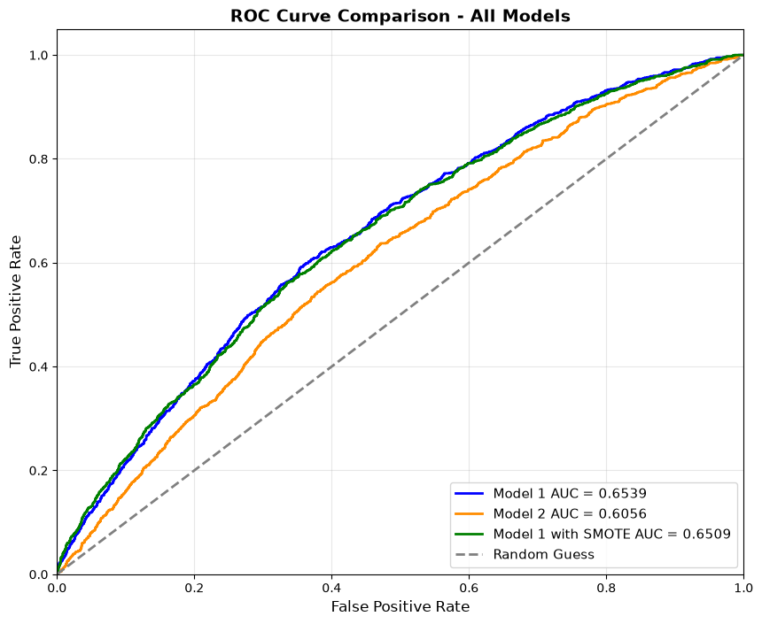
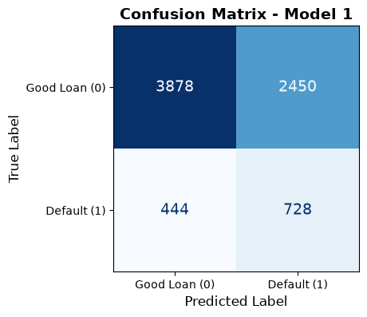
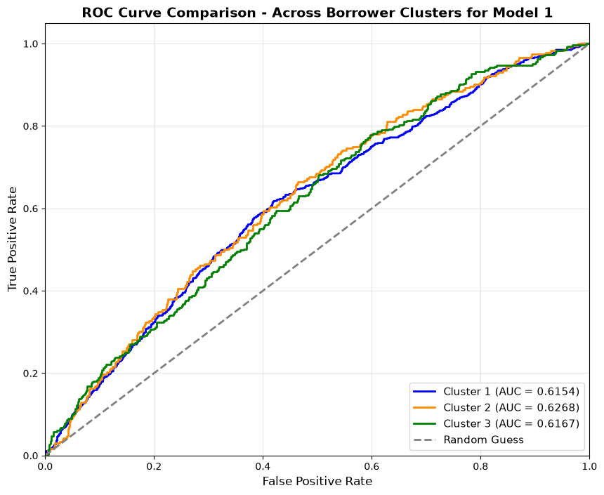

# 💳 Loan Default Prediction with Neural Networks (PyTorch)

**Tools:** Python · PyTorch · scikit-learn · imbalanced-learn (SMOTE, undersampling) · pandas · Matplotlib
**Context:** MSc Business Analytics coursework (Deep Learning), University of Warwick (2026)

A lender wants to **predict which loans will default at the time of application**, so it can cut losses without turning away too many good borrowers. I built and compared three neural-network classifiers on **50,000 personal loans issued in 2012–2013**. Only **15.6% of them defaulted**, which made class imbalance the main challenge.

📓 **[View the full notebook with code and output →](loan_default_prediction.ipynb)**

---

## 💡 Key results



| Model | Imbalance handling | ROC-AUC | Defaults caught (recall) | Good loans approved |
|---|---|---|---|---|
| **Model 1 (chosen)** | Random undersampling | **0.654** | **62%** (728 of 1,172) | **61%** |
| Model 2: no dropout, batch norm or early stopping | Random undersampling | 0.606 | 59% | 56% |
| Model 3: Model 1 architecture | SMOTE oversampling | 0.651 | 66% | 56% |

*All results are on a held-out test set of 7,500 loans, using a 0.5 decision threshold.*

- **I picked Model 1** because it had the best ROC-AUC and the best balance between catching defaulters and approving good borrowers.
- **SMOTE caught a few more defaulters but declined noticeably more good customers,** with no gain in ROC-AUC. The trade-off wasn't worth the extra synthetic data.
- **Regularisation matters.** Without dropout, batch norm and early stopping, Model 2 overfit: training accuracy kept climbing to 71% while validation accuracy swung between 50% and 64%. It ended with the lowest ROC-AUC.



**What this means for a lender:** Model 1 flags 62% of the loans that will go bad. In return, it also flags 39% of good loans for review. A default usually costs far more than the profit lost on one declined loan, so the decision threshold can be **moved to suit the lender's actual costs**. Lowering it catches more defaulters, and raising it approves more good borrowers.

### Performance by borrower risk segment (test loans only)

I also scored the models separately on three borrower risk segments (low, medium and high risk), using only the loans the models had never seen.

| Segment | Test loans | Default rate | Model 1 ROC-AUC | Defaults caught | Good loans approved |
|---|---|---|---|---|---|
| Low risk | 2,361 | 9.8% | 0.63 | 19% | 90% |
| Medium risk | 3,695 | 16.2% | 0.62 | 65% | 54% |
| High risk | 1,444 | 23.8% | 0.62 | 87% | 28% |



The model ranks borrowers similarly well in each segment, with an ROC-AUC of 0.62–0.63. Its decisions at a 0.5 threshold, though, follow each segment's overall risk: it approves most low-risk borrowers and flags most high-risk ones. A lender could use **a different threshold for each segment**, or concentrate manual reviews on the medium-risk group, where the model separates the two outcomes most evenly.

**Model 1 had the highest ROC-AUC in every segment.** Model 2 had the lowest, at 0.57–0.58.

---

## 🔍 Approach

**1. Feature selection.** I used only information available **at application time**: loan amount, interest rate, income, debt-to-income, credit history, home ownership and verification status. That keeps the model realistic and avoids leaking outcome information. I left out loan grade because it's highly correlated with interest rate.

**2. Data preparation**
- I dropped three features with more than 50% missing values (months since last delinquency, record and major derogatory event).
- Missing balance and credit-limit values were filled with the median.
- Loan amount and annual income were log-transformed to reduce skew.
- Categorical variables were one-hot encoded and all features standardised with `StandardScaler`, giving 15 features in total.
- I made a **stratified 70 / 15 / 15 train, validation and test split**, so every set keeps the 15.6% default rate.

**3. Handling class imbalance.** With only 15.6% defaults, a model that predicts "no default" for everyone is 84% accurate and completely useless. So I:
- balanced the **training set only**, using either random undersampling (5,470 of each class) or SMOTE (29,533 of each class); the validation and test sets keep the real-world class mix
- judged the models on **ROC-AUC and recall**, not accuracy.

**4. Model architecture (Model 1).** A 4-hidden-layer feed-forward network (15 → 32 → 64 → 32 → 16 → 1) with **batch normalisation, ReLU and dropout (0.2–0.3)** after each layer, and a sigmoid output.
- **Training:** binary cross-entropy loss, Adam (learning rate 0.0005, weight decay 1e-4), and a ReduceLROnPlateau scheduler.
- **Early stopping:** patience of 15 epochs on validation loss, then the **best-epoch weights are restored** before testing.
- **Reproducibility:** all random seeds are fixed.

---

## 📁 Repository structure

```
loan-default-prediction/
├── README.md
├── loan_default_prediction.ipynb   # full notebook: preprocessing, 3 models, evaluation, segment analysis
├── data/
│   └── loan_data.csv               # 50,000 loans: the application-time fields used, outcome and risk segment
└── images/                         # charts used in this README
```

## ▶️ How to run

```bash
pip install torch pandas numpy scikit-learn imbalanced-learn matplotlib jupyter
jupyter notebook loan_default_prediction.ipynb
```

Then run all cells. The notebook runs on CPU in a few minutes, and a GPU is used automatically if one is available. GPU runs give very slightly different numbers.

## 🔭 Next steps

- **Compare against simpler models:** logistic regression or gradient boosting (e.g. XGBoost) often match neural networks on tabular data and are easier to explain to a credit committee.
- **Tune the decision threshold** on the validation set using the lender's real cost of a default versus a declined good loan, possibly with a different threshold for each risk segment.
- Add **explainability** (e.g. SHAP) to show which features drive each prediction.
